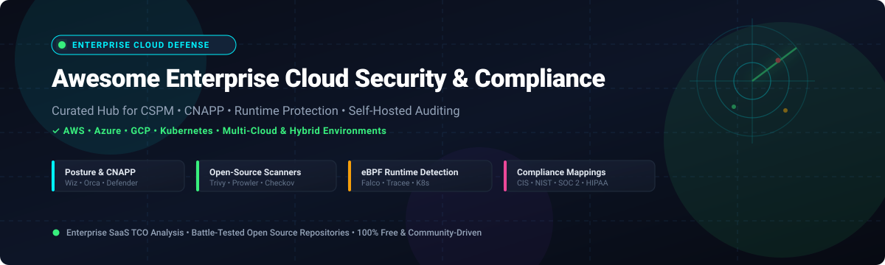

  

# 🛡️ Awesome Enterprise Cloud Security & Compliance

### ⚡ Curated Directory of Enterprise SaaS Platforms & Open-Source Security Scanners
*Comprehensive analysis of Cloud Security Posture Management (CSPM), Cloud-Native Application Protection Platforms (CNAPP), Runtime Workload Defense, and Kubernetes Compliance Frameworks across AWS, Azure, GCP, and Multi-Cloud Environments.*

---

## 📌 Table of Contents
- [📖 Overview & SEO Summary](#-overview--seo-summary)
- [📈 Sector Overview & Market Dynamics](#-sector-overview--market-dynamics)
- [☁️ Enterprise SaaS & Hosted Platforms](#️-enterprise-saas--hosted-platforms)
- [🔓 Open-Source GitHub Projects (Ranked by Stars)](#-open-source-github-projects-ranked-by-stars)
- [🤝 How to Contribute](#-how-to-contribute)
- [💖 Support](#-support)
- [📊 Star History](#-star-history)
- [⚠️ Disclaimer](#️-disclaimer)

---

## 📖 Overview & SEO Summary

Welcome to the definitive **Enterprise Cloud Security & Compliance** repository—an industry-benchmarked index engineered for Chief Information Security Officers (CISOs), Cloud Architects, DevSecOps practitioners, and SOC analysts.

This guide delivers side-by-side **total cost of ownership (TCO) benchmarks, specific pricing tiers, free trial parameters, and technical trade-offs** for the entire enterprise cloud defense surface:
- **Cloud Security Posture Management (CSPM):** Multi-cloud automated configuration auditing against CIS Benchmarks, NIST SP 800-53, PCI-DSS, ISO 27001, HIPAA, and SOC 2.
- **Cloud-Native Application Protection Platforms (CNAPP):** Unified agentless graph analysis merging infrastructure posture, container supply chains, identity and entitlements (CIEM), and runtime anomalies.
- **Cloud Workload Protection (CWPP) & eBPF Runtime Security:** Real-time threat detection, kernel-level zero-day interception, and behavioural heuristics inside Kubernetes and serverless workloads.
- **Shift-Left Security & Infrastructure as Code (IaC) Scanning:** Pre-flight detection of misconfigurations, hardcoded credentials, and CVEs across Terraform, OpenTofu, CloudFormation, and Dockerfiles.

---

## 📈 Sector Overview & Market Dynamics

The global enterprise cloud security market is valued at approximately **$40 billion to $45 billion in 2026**, with the high-velocity Cloud-Native Application Protection Platform (CNAPP) sector surpassing **$12.5 billion** while compounding at an aggressive **>20% CAGR**.

Historically fragmented across dozens of siloed point solutions (isolated CSPM scanners, distinct container imagers, standalone IAM auditors), the industry is undergoing an acute wave of **hyper-concentration and platform consolidation**. Enterprise security buyers are actively retiring alert-heavy point tools in favor of unified, single-pane platforms spearheaded by cloud hyperscalers (Microsoft, Google Cloud, AWS) and consolidated cybersecurity giants (Palo Alto Networks, CrowdStrike, Datadog). Concurrently, cloud-native champions (such as Wiz, acquired by Alphabet for $32 billion) have reset enterprise expectations around agentless security graphs. In contrast, self-hosted open-source security frameworks (Prowler, Trivy, Falco, Checkov) serve as critical community counterweights—providing organizations with unmetered multi-cloud governance and total data sovereignty.

---

## ☁️ Enterprise SaaS & Hosted Platforms

*Below is a comprehensive enterprise comparison sorted descending by **Company Market Capitalization / Valuation**.*

| Product | Company Size / Valuation | Description | Pricing (Starting Tier) | Free Tier & Trial Limits |
|:---|:---|:---|:---|:---|
| **[Microsoft Defender for Cloud](https://azure.microsoft.com/en-us/products/defender-for-cloud/)** | ~$3.89 Trillion *(MSFT Market Cap)* | **Widest hybrid and multi-cloud coverage** across Azure, AWS, GCP, and on-premises via Azure Arc. Provides out-of-the-box regulatory compliance dashboards. **Trade-off:** Per-resource pricing can accelerate in elastic workloads; advanced capabilities require paid tiers. | **Foundational CSPM:** $0 (Included with Azure); **Defender CSPM:** ~$5.11/billable resource/month; **Defender for Servers:** ~$4.91/server/month (Plan 1) | **Free forever:** Foundational CSPM (secure score, continuous assessment, basic recommendations). **Free trial:** 30-day free trial per Azure plan/resource type (1 trial per AWS account/GCP project); excludes storage malware scanning. |
| **[Google Security Command Center](https://cloud.google.com/security-command-center)** | ~$3.60 Trillion *(Alphabet Market Cap)* | **Premier native posture and threat detection for Google Cloud and GKE workloads.** Delivers workload-level threat models (VMs, containers, audit events). **Trade-off:** Non-GCP multi-cloud visibility is minimal. | **Standard Tier:** $0 (Free baseline); **Premium PAYG:** Starts at $0.0071/vCPU-hour for Compute Engine / Cloud Run; **Premium Subscription:** ~5% of annualized GCP spend (min. ~$15,000/yr) | **Free forever (Standard tier):** Continuous asset discovery, basic security health analytics, and vulnerability finding exports (subject to 500 MB/day findings upload cap and 1,000 req/min API quota). |
| **[AWS Security Hub](https://aws.amazon.com/security-hub/)** | ~$2.88 Trillion *(Amazon Market Cap)* | **Native command center for AWS footprints**, consolidating findings across GuardDuty, Inspector, Macie, IAM Access Analyzer, and AWS Config. **Trade-off:** No perpetual free posture checks; scales with check volumes. | **Security Checks (CSPM):** $0.0010 per security check (first 100,000 checks/account/region/month; AWS Config billed separately); **Finding Ingestion:** $0.00003 per event beyond free limit | **Free forever:** First 10,000 finding ingestion events/account/region/month (findings from native checks always free). **Free trial:** 30-day free trial per account across all regions for Security Hub Essentials checks. |
| **[Palo Alto Prisma Cloud](https://www.paloaltonetworks.com/prisma/cloud)** | ~$263 Billion *(PANW Market Cap)* | **Broadest enterprise CNAPP on paper** with deep compliance libraries and custom policy engines. **Trade-off:** Significant operational overhead, multi-agent management, and complex credit burn rates. | Enterprise credit-based licensing starting at **~$30,000/year** (purchased in blocks of 100 Prisma Cloud Credits; consumption scaled by workload/container/identity volume) | **No perpetual free tier**. **Free trial:** 30-day free trial / guided Proof of Concept (PoC) scoped to specific cloud accounts and core CNAPP capabilities (CSPM/CWP). |
| **[CrowdStrike Falcon Cloud Security](https://www.crowdstrike.com/)** | ~$234 Billion *(CRWD Market Cap)* | Cloud workload protection (CWP) and posture management (CSPM) extending Falcon's single-agent architecture into containers, Kubernetes, and cloud compute. | Annual enterprise contract based on workload/node volume (Flex License starts at **~$233.99** per workload/seat for 3-yr terms via enterprise distribution) | **No perpetual free tier**. **Free trial:** 15-day free trial of the CrowdStrike Falcon platform with access to activate Falcon Cloud Security modules; extendable via sales. |
| **[Lacework FortiCNAPP](https://www.lacework.com/)** | ~$90 Billion *(Fortinet Market Cap; acquired for $152.3M)* | **Mature behavioural anomaly detection via Polygraph** integrated into Fortinet's enterprise ecosystem. **Trade-off:** Multi-tier vCPU packaging shrinks workload allowances as tiers rise. | AWS Marketplace minimum starting tier: **$25,000/12 months** (Standard tier capped at 500 vCPUs; Pro capped at 334 vCPUs; Enterprise capped at 250 vCPUs) | **No perpetual free tier**. **Free trial:** 30-day negotiated Proof of Value (PoV) evaluation granted via Fortinet sales/marketplace with predefined test criteria. |
| **[Datadog Cloud Security](https://www.datadoghq.com/)** | ~$65 Billion *(DDOG Market Cap)* | Unified cloud security management (CSM) and runtime threat detection directly embedded within Datadog's observability stack. | **CSM Pro:** **$10/host/month** billed annually ($12/host on-demand month-to-month; requires base Infrastructure tier at $15/host/month); **CWS:** **$15/host/month** ($180/host/year) | **Free forever (Core platform):** Free tier capped at 5 hosts (1-day metric retention). **Free trial:** 14-day full-access free trial for Datadog Cloud Security Management (CSM/CWS) across connected hosts and cloud accounts. |
| **[Wiz](https://www.wiz.io/)** | $32 Billion *(Alphabet Acquisition)* | **Agentless CNAPP with rapid deployment and high-fidelity attack path graph visualization.** Correlates vulnerabilities, misconfigurations, and excessive identities. **Trade-off:** SaaS-only architecture. | Workload-based annual enterprise license starting at **~$24,000/year** (typically covering ~100 workloads across CSPM/vulnerability scanning modules) | **No perpetual free tier**. **Free trial:** 14 to 30 days guided Proof of Concept (PoC) scoped to specific cloud accounts/workloads with full code-to-cloud graph scanning. |
| **[Orca Security](https://orca.security/)** | ~$1.8 Billion *(Private Valuation)* | **Agentless SideScanning technology** reading cloud block storage out-of-band to uncover OS CVEs, misconfigurations, malware, and credential leaks without runtime agents. | AWS Marketplace listed entry plan starting at **$124,440/year** for Small-Medium enterprise tier; custom private offers scaled by average concurrent compute workloads | **No perpetual free tier**. **Free trial:** 30-day cloud risk assessment / Proof of Concept trial provisioned via AWS Marketplace or direct sales. |

---

## 🔓 Open-Source GitHub Projects (Ranked by Stars)

*Self-hosted, transparent, and auditable open-source cloud security frameworks. Ranked in descending order of GitHub stargazers.*

| Project | Stars | Focus Category | Description |
|:---|:---:|:---|:---|
| **[Trivy](https://github.com/aquasecurity/trivy)** |  | Vulnerability & IaC Scanning | **The gold standard for container, filesystem, Git repo, and cloud security scanning.** Detects CVEs, misconfigurations (Terraform, Dockerfile, K8s), exposed secrets, and SBOM licenses under Apache 2.0. |
| **[Prowler](https://github.com/prowler-cloud/prowler)** |  | Multi-Cloud CSPM & Compliance | **The leading open-source multi-cloud security posture scanner.** Features 500+ checks across AWS, Azure, GCP, Kubernetes, and Microsoft 365 mapped directly to CIS, NIST, ISO 27001, HIPAA, and PCI-DSS. |
| **[Syft](https://github.com/anchore/syft)** |  | SBOM & Supply Chain Security | **CLI tool and Go library for generating a Software Bill of Materials (SBOM)** from container images and filesystems. Exceptional cataloger for packages, dependencies, and software supply chain compliance. |
| **[Falco](https://github.com/falcosecurity/falco)** |  | eBPF Runtime Security | **CNCF graduated runtime threat detection for Linux, Kubernetes, and cloud containers.** Leverages eBPF kernel instrumentation to detect suspicious syscalls, file tamperings, and unexpected network egress in real-time. |
| **[Checkov](https://github.com/bridgecrewio/checkov)** |  | Static IaC & Policy as Code | **Static code analysis tool for infrastructure-as-code (IaC).** Scans Terraform, CloudFormation, Kubernetes, Helm, ARM, and Serverless framework against 1,000+ built-in policies for posture regressions. |
| **[Kube-bench](https://github.com/aquasecurity/kube-bench)** |  | Kubernetes CIS Benchmark | **Go-based compliance checker evaluating Kubernetes clusters** against the CIS Kubernetes Benchmark. Runs as a container, job, or daemonset inside master and worker nodes. |
| **[Steampipe](https://github.com/turbot/steampipe)** |  | SQL-Based Cloud Querying | **Query cloud APIs, identity providers, and container infrastructure using standard SQL.** Connects with 100+ plugins (AWS, Azure, GCP, GitHub, K8s) for compliance audits, drift detection, and custom dashboards. |
| **[Scout Suite](https://github.com/nccgroup/ScoutSuite)** |  | Multi-Cloud Auditing | **Open-source multi-cloud security auditing tool by NCC Group.** Queries cloud management APIs to highlight posture gaps across AWS, Azure, GCP, and Oracle Cloud into interactive HTML dashboards. |
| **[tfsec](https://github.com/aquasecurity/tfsec)** |  | Terraform Static Analysis | **Blazing fast security scanner for Terraform code.** Runs client-side without cloud API credentials to catch unencrypted storage, exposed ingress ports, and permissive IAM before deployment. |
| **[Cloud Custodian](https://github.com/cloud-custodian/cloud-custodian)** |  | Cloud Governance & Remediation | **Rules engine for cloud security, governance, and cost management.** Defines simple YAML policies that evaluate resources continuously and trigger automated remediation actions (tagging, stopping, encrypting). |
| **[Terrascan](https://github.com/tenable/terrascan)** |  | Multi-IaC Security Scanner | **500+ out-of-the-box policies written in Rego (OPA)** for scanning Terraform, Kubernetes manifests, Helm charts, Dockerfiles, and Kustomize templates. |
| **[Tracee](https://github.com/aquasecurity/tracee)** |  | eBPF Threat Detection & Forensic | **Runtime security and forensic tracing tool powered by Linux eBPF.** Monitors system calls, process lifecycles, and kernel execution events to identify suspicious behavior patterns in container environments. |
| **[Gatekeeper](https://github.com/open-policy-agent/gatekeeper)** |  | Kubernetes Admission Control | **Validating and mutating webhook that enforces CRD-based policies** in Kubernetes via Open Policy Agent (OPA). Prevents privilege escalation, enforces resource quotas, and rejects non-compliant pods at admission. |
| **[CloudSploit](https://github.com/aquasecurity/cloudsploit)** |  | CSPM Scanner Engine | **Lightweight open-source cloud security scanning engine.** Audits AWS, Azure, GCP, and Oracle Cloud accounts for security misconfigurations, compliance non-conformance, and architectural best practices. |
| **[OpenClarity](https://github.com/openclarity/openclarity)** |  | Cloud-Native Security Suite | **CNCF-hosted unified cloud-native security and observability platform.** Discovers assets, detects SBOM packages, vulnerabilities, secrets, malware, and misconfigurations across VMs and containers. |

---

## 🤝 How to Contribute

Contributions from the cloud security and DevSecOps community are warmly welcomed! 🚀

1. 🍴 **Fork the repository** on GitHub.
2. 🌿 **Create a new branch** (`git checkout -b feature/new-security-tool`).
3. ✍️ **Add or enrich entries** in `README.md` adhering to the standard schema:
   - Factual pricing with starting tiers (no generic placeholders).
   - Concrete free tier limits or exact trial durations.
   - For open-source entries, ensure official GitHub link and stargazers badge (`style=social&color=white`).
4. 🧪 **Verify markdown rendering and links**.
5. 📬 **Submit a Pull Request** with a concise description of the addition.

---

## 💖 Support

If this curated enterprise security guide saved your organization time, prevented a costly misconfiguration, or assisted your cloud audit, please consider supporting the project:

- ⭐ **Star this repository** to improve discoverability for other cloud architects.
- 🍴 **Fork and share** with your security and engineering teams.
- ☕ **Sponsor or buy a coffee**: [Support the maintainer on GitHub Sponsors](https://github.com/sponsors/ishandutta2007) ❤️

---

## 📊 Star History

---

## ⚠️ Disclaimer

- This repository is a **community-curated research resource** for educational and architectural evaluation purposes—it is not an endorsement or legal certification.
- Cloud security platforms require broad administrative or read-only IAM access across cloud APIs and workload metadata; always follow the principle of least privilege (PoLP) and conduct credential audits.
- **Licensing and pricing models change frequently**: verify quote terms, vCPU/workload caps, egress bandwidth fees, and cloud audit logging costs directly with respective vendors prior to deployment.

---

  Maintained with 🛡️ for cloud security engineers, SOC analysts, and organizations securing multi-cloud environments worldwide.

